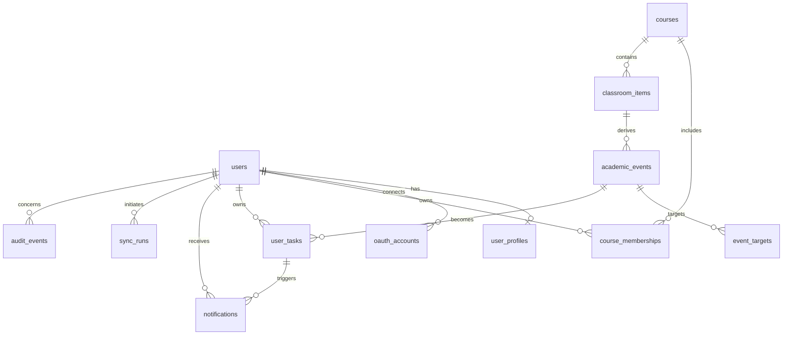

# Database design

PostgreSQL is the only backend database. UUIDs are application-facing identifiers and all
timestamps are timezone-aware; canonical values are stored in UTC. Private repository methods
require the authenticated `user_id`, and access to course-derived records is joined through
`course_memberships`.

## Integrity and query policy

- `(provider, classroom_course_id)` uniquely identifies a course.
- `(course_id, source_type, source_id)` makes Classroom ingestion idempotent.
- `(classroom_item_id, extraction_version)` prevents duplicate extraction results.
- `(user_id, academic_event_id)` prevents duplicate per-user tasks.
- User, course, due-date, creation-date, unread, and relevance paths are indexed.
- Cascading foreign keys make account deletion deterministic.
- Client-facing error handling always returns a generic `internal_error`; SQL, schema names,
  credentials, and provider details are not exposed.

## Raw text retention

Raw Classroom titles and bodies are retained for 90 days by default so students can verify
derived events and extraction errors can be diagnosed. A scheduled cleanup will blank expired
body text after the source is normalized, while retaining source IDs, hashes, URLs, and derived
events. This period must be reviewed before real production data is collected; account deletion
always takes precedence and removes the records immediately from the live database.

## Credentials, migration, and backup policy

Application traffic uses a restricted account that can read and modify application rows but
cannot change schema. Alembic uses `MIGRATION_DATABASE_URL`, a separate direct-TLS credential
allowed to perform schema migrations. Local development may initially use the Compose owner
credential, but preview and production must use separate roles before deployment.

Production backups use only Neon's encrypted backup/restore facilities. Production dumps and
records must never be copied into development; local seed data is entirely synthetic.
